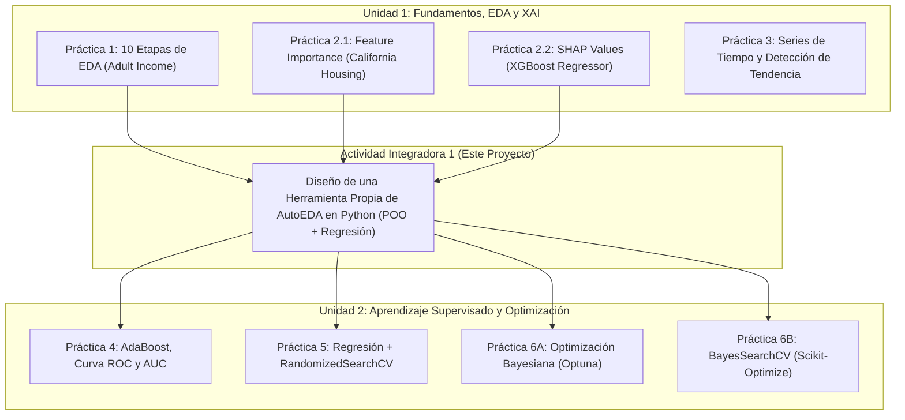
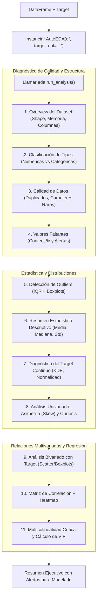
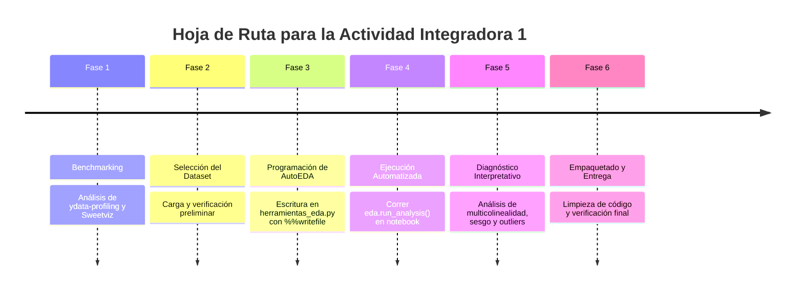

# Guía Maestra y Plan de Ejecución — Actividad Integradora 1: EDA Automatizado
## Asignatura: Aplicaciones de Machine Learning

---

## 1. Contexto General y Propósito

El presente documento establece la hoja de ruta técnica, metodológica y pedagógica para completar la **Actividad Integradora 1: Análisis Exploratorio de Datos (EDA)** de la asignatura **Aplicaciones de Machine Learning**.

### 1.1 Articulación en el Repositorio

El repositorio integra conocimientos distribuidos a través de dos unidades temáticas:



La **Actividad Integradora 1** consolida la base empírica de la **Unidad 1** (especialmente la [Práctica 1](file:///home/cideif/Documentos/Proyect-Local/Uni_ejercicios/Bimestre%205%202026/APLICACIONES-DE-MACHINE-LEARNING/Unidad%201/Practica1-EDA.ipynb)), transformando un procedimiento exploratorio interactivo en una **herramienta modular, reutilizable y automatizada orientada a objetos (POO)**. Su finalidad directa es preparar y sanear datos para modelos supervisados de regresión (vistos en las Prácticas 2.1, 2.2 y 5).

---

## 2. Análisis del Enunciado Oficial (`Integradora 1/Ejercicio`)

De acuerdo con el archivo oficial [Ejercicio](file:///home/cideif/Documentos/Proyect-Local/Uni_ejercicios/Bimestre%205%202026/APLICACIONES-DE-MACHINE-LEARNING/Integradora%201/Ejercicio), los requisitos y disposiciones obligatorias son:

> **Objetivo Oficial:**
> Diseñar y programar una herramienta propia de EDA automatizado en Python capaz de procesar un dataset y generar de forma 100% automatizada un diagnóstico estadístico, visual y de calidad de datos, optimizado para identificar problemas clave en modelos de regresión como la **multicolinealidad**, el **sesgo** y los **valores atípicos**. Se deben incluir todos los **10 puntos de EDA** que se mostraron en la clase.
> El estudiante es libre de usar un dataset a su conveniencia (Kaggle, UCI).

### 2.1 Requisitos Mandatorios Desglosados

1. **Automatización 100%:** La herramienta debe recibir un DataFrame (y opcionalmente el nombre de la variable objetivo) y ejecutar la batería de análisis e informes sin requerir código manual adicional celda por celda.
2. **Orientación a Modelos de Regresión:**
   - Detección de **multicolinealidad** (correlaciones bivariadas cruzadas elevadas y Factor de Inflación de la Varianza - VIF).
   - Detección de **sesgo (skewness)** y curtosis en distribuciones de predictores y del target, alertando la necesidad de transformaciones matemáticas (e.g., $\log$, Box-Cox).
   - Identificación de **valores atípicos (outliers)** que comprometan la función de pérdida por mínimos cuadrados ($MSE/RMSE$).
3. **Inclusión de los 10 Puntos de EDA de Clase:** Cobertura estricta de las etapas abordadas en la [Práctica 1](file:///home/cideif/Documentos/Proyect-Local/Uni_ejercicios/Bimestre%205%202026/APLICACIONES-DE-MACHINE-LEARNING/Unidad%201/Practica1-EDA.ipynb).
4. **Arquitectura Orientada a Objetos (`CLASS`):** Encapsulamiento de la lógica en una clase en Python (`AutoEDA`) para maximizar la reutilización y modularidad.
5. **Generación Modular con `%%writefile`:** Uso del comando mágico de Jupyter/Colab para exportar el código de la clase al script autónomo [herramientas_eda.py](file:///home/cideif/Documentos/Proyect-Local/Uni_ejercicios/Bimestre%205%202026/APLICACIONES-DE-MACHINE-LEARNING/Integradora%201/herramientas_eda.py).
6. **Benchmarking frente a Herramientas de Referencia:** Comparar los resultados frente a herramientas consolidadas del ecosistema como `ydata-profiling` y `Sweetviz`, las cuales ya cuentan con cuadernos y reportes HTML de muestra en el repositorio ([herramientas_EDA_(3).ipynb](file:///home/cideif/Documentos/Proyect-Local/Uni_ejercicios/Bimestre%205%202026/APLICACIONES-DE-MACHINE-LEARNING/Integradora%201/herramientas_EDA_(3).ipynb), [diagnostico_ydata.html](file:///home/cideif/Documentos/Proyect-Local/Uni_ejercicios/Bimestre%205%202026/APLICACIONES-DE-MACHINE-LEARNING/Integradora%201/diagnostico_ydata.html), [reporte_adult_sweetviz.html](file:///home/cideif/Documentos/Proyect-Local/Uni_ejercicios/Bimestre%205%202026/APLICACIONES-DE-MACHINE-LEARNING/Integradora%201/reporte_adult_sweetviz.html)).

---

## 3. Los 10 Puntos de EDA de Clase Integrados en la Solución

A continuación se detalla la correspondencia conceptual entre los 10 puntos de la clase (observados en `Unidad 1/Practica1-EDA.ipynb`) y su implementación programática automatizada:

| # | Punto de EDA de Clase | Operaciones Básicas | Implementación Automatizada en `AutoEDA` (Enfoque Regresión) |
|---|---|---|---|
| **1** | **Conocer el dataset** | `head()`, `tail()`, `shape`, `sample()`, `columns` | Inspección de dimensiones $(N \times P)$, memoria consumida (`memory_usage(deep=True)`), muestra de filas y catálogo de columnas. |
| **2** | **Tipo de variable** | `info()`, `dtypes`, `select_dtypes` | Clasificación automática en: (a) Numéricas Continuas, (b) Numéricas Discretas (baja cardinalidad), (c) Categóricas Nominales/Ordinales y (d) Identificadores de alta cardinalidad. |
| **3** | **Calidad de datos** | `duplicated()`, búsqueda de `"?"`, `strip()` | Detección de duplicados exactos, conteo de valores centinela (`"?"`, `"-"`, `"N/A"`, `"None"`), advertencia de espacios en blanco en strings (`" <=50K"`). |
| **4** | **Valores faltantes** | `isnull().sum()`, `%` de nulos | Reporte tabular ordenado por severidad de nulos, clasificación de alerta (< 5% imputable, 5-30% imputación avanzada, > 30% candidata a descarte) y visualización opcional de incompletitud. |
| **5** | **Outliers (Valores atípicos)** | Boxplot, Cuartiles $Q_1$, $Q_3$, $IQR$ | Cálculo del Rango Intercuartílico ($IQR = Q_3 - Q_1$), conteo de outliers leves ($1.5 \times IQR$) y extremos ($3.0 \times IQR$) con visualización de Boxplots en cuadrícula. |
| **6** | **Estadística descriptiva** | `describe()`, media, desviación | Matriz resumida: media, mediana, desviación estándar, rango intercuartílico, mínimo y máximo. Ratio de dispersión ($CV = \sigma / \mu$). |
| **7** | **Variable objetivo (Target)** | `value_counts()` (clasificación) / Histograma (regresión) | Para **regresión**: Histograma con KDE del target, evaluación de normalidad (media vs mediana), cálculo de asimetría y recomendación de transformación logarítmica si $|skew| > 1$. |
| **8** | **Análisis univariado y distribuciones** | Histograma, `skew()`, `kurt()` | Cálculo automatizado de **asimetría (Skewness)** y **curtosis** para todos los predictores numéricos. Generación de cuadrícula de distribuciones (KDE) y alertas de sesgo severo ($|skew| > 1.5$). |
| **9** | **Análisis bivariado (Feature vs. Target)** | `scatterplot()`, comparativa cruzada | - Numéricas vs Target: Scatter plots con recta de tendencia (`regplot`) y ranking de correlación de Pearson con el target.<br>- Categóricas vs Target: Boxplots agrupados por categoría. |
| **10** | **Análisis multivariado y multicolinealidad** | `corr()`, Heatmap | - Heatmap de correlaciones Pearson.<br>- Detección de pares con alta colinealidad ($|r| \ge 0.80$).<br>- **Cálculo del Factor de Inflación de la Varianza (VIF)** para predictores continuos. |

---

## 4. Arquitectura del Módulo `herramientas_eda.py`

### 4.1 Diagrama de Flujo del Proceso Automatizado



### 4.2 Métodos Propuestos para la Clase `AutoEDA`

El archivo actual [herramientas_eda.py](file:///home/cideif/Documentos/Proyect-Local/Uni_ejercicios/Bimestre%205%202026/APLICACIONES-DE-MACHINE-LEARNING/Integradora%201/herramientas_eda.py) contiene una versión base simplificada. La versión completa para la actividad integradora debe estructurarse de la siguiente manera:

```python
class AutoEDA:
    def __init__(self, df: pd.DataFrame, target_col: str = None, figsize: tuple = (10, 6)):
        """
        Inicializa el pipeline de EDA con el DataFrame y la variable dependiente.
        """
        self.df = df.copy()
        self.target_col = target_col
        self.figsize = figsize
        self._classify_columns()

    # Métodos privados de diagnóstico por punto:
    def _classify_columns(self): ...             # Punto 2
    def _diagnose_overview(self): ...             # Punto 1
    def _diagnose_quality_and_missing(self): ...  # Puntos 3 y 4
    def _detect_outliers_iqr(self): ...           # Punto 5
    def _descriptive_statistics(self): ...        # Punto 6
    def _analyze_target(self): ...                # Punto 7 (enfoque regresión)
    def _analyze_univariate_skewness(self): ...   # Punto 8 (sesgo y curtosis)
    def _analyze_bivariate_relationships(self): ...# Punto 9 (features vs target)
    def _analyze_multicollinearity_and_vif(self): ... # Punto 10 (correlaciones y VIF)
    def _generate_regression_alerts(self): ...    # Diagnóstico final

    # Método orquestador público:
    def run_analysis(self): ...                   # Dispara el flujo secuencial completo
```

---

## 5. Selección y Recomendación de Datasets (Kaggle y UCI)

El enunciado establece libertad en la elección del dataset, sugiriendo repositorios como [Kaggle](https://www.kaggle.com/datasets) y [UCI Machine Learning Repository](https://archive.ics.uci.edu/datasets). Para maximizar el aprovechamiento de los diagnósticos de **regresión** (multicolinealidad, sesgo y outliers), se recomiendan las siguientes alternativas:

| Dataset | Origen | Dimensiones aproximadas | Variable Objetivo (Target) | Características que ponen a prueba la herramienta |
|---|---|---|---|---|
| **Medical Cost Personal Datasets (Insurance)** *(Altamente Recomendado)* | Kaggle / GitHub | 1,338 filas, 7 columnas | `charges` (Gasto médico en USD) | - Fuerte **sesgo a la derecha** en el target `charges` ($skew > 1.5$).<br>- Presencia de **outliers** notables en gastos médicos.<br>- Mezcla equilibrada de variables categóricas (`smoker`, `region`, `sex`) y numéricas (`age`, `bmi`). |
| **California Housing** | Scikit-learn / UCI | 20,640 filas, 8 columnas | `MedHouseVal` (Valor medio de vivienda) | - Fuerte **multicolinealidad** física (`AveRooms` vs `AveBedrms`, `Latitude` vs `Longitude`).<br>- Datos numéricos continuos con outliers por límite superior censal. Ya conocido por Prácticas 2.1 y 2.2. |
| **Real Estate Valuation** | UCI Repository | 414 filas, 7 columnas | `Y house price of unit area` | - Alta multicolinealidad con la distancia al transporte público (MRT station).<br>- Fácil de inspeccionar visualmente por su tamaño moderado. |
| **Ames Housing (House Prices)** | Kaggle | 1,460 filas, 80 columnas (subconjunto de 10-15 vars) | `SalePrice` | - El caso clásico de multicolinealidad en regresión (metros de garaje vs número de autos, superficie primer piso vs total). |

> [!TIP]
> **Recomendación Práctica:** El dataset **Medical Cost Personal Datasets (Insurance)** o el **California Housing** son ideales porque no requieren preprocesamiento excesivo previo y permiten evidenciar con gran claridad los diagnósticos de sesgo, outliers y multicolinealidad.

---

## 6. Plan de Ejecución Paso a Paso (Roadmap del Estudiante)

El estudiante debe seguir este plan de 6 fases secuenciales para garantizar el cumplimiento íntegro:



### Fase 1: Benchmarking con Herramientas de Referencia
1. Abrir el notebook [herramientas_EDA_(3).ipynb](file:///home/cideif/Documentos/Proyect-Local/Uni_ejercicios/Bimestre%205%202026/APLICACIONES-DE-MACHINE-LEARNING/Integradora%201/herramientas_EDA_(3).ipynb).
2. Revisar la sección 1 (`ydata-profiling`) y sección 2 (`Sweetviz`).
3. Examinar los reportes generados en HTML:
   - [diagnostico_ydata.html](file:///home/cideif/Documentos/Proyect-Local/Uni_ejercicios/Bimestre%205%202026/APLICACIONES-DE-MACHINE-LEARNING/Integradora%201/diagnostico_ydata.html)
   - [reporte_adult_sweetviz.html](file:///home/cideif/Documentos/Proyect-Local/Uni_ejercicios/Bimestre%205%202026/APLICACIONES-DE-MACHINE-LEARNING/Integradora%201/reporte_adult_sweetviz.html)
4. Tomar nota de qué información visual y estadística aporta cada librería y cómo inspiran el diseño de la herramienta propia.

### Fase 2: Selección y Carga del Dataset
1. Elegir un dataset de regresión (ej. *Medical Cost* o *California Housing*).
2. Cargar el dataset en una celda de Jupyter / Google Colab usando `pandas.read_csv()`.
3. Especificar la variable objetivo que servirá como target para los análisis bivariados y de regresión (ej. `target_col = 'charges'`).

### Fase 3: Implementación de la Clase `AutoEDA` en `herramientas_eda.py`
1. Crear una celda en el cuaderno de trabajo con el comando mágico en la primera línea:
   ```python
   %%writefile herramientas_eda.py
   ```
2. Implementar los **10 puntos de la clase** dentro de la estructura de la clase `AutoEDA`:
   - Cálculo de estadísticas y conteo de duplicados/nulos.
   - Cálculo del IQR y conteo de outliers.
   - Cálculo de skewness y kurtosis con `scipy.stats` o `.skew()` de pandas.
   - Gráficos univariados y bivariados con `matplotlib` y `seaborn`.
   - Matriz de correlación y detección de pares con $|r| \ge 0.8$.
   - Cálculo del VIF (Factor de Inflación de la Varianza) para diagnosticar multicolinealidad:
     ```python
     from statsmodels.stats.outliers_influence import variance_inflation_factor
     ```
3. Ejecutar la celda para que se genere y sobrescriba el archivo físico [herramientas_eda.py](file:///home/cideif/Documentos/Proyect-Local/Uni_ejercicios/Bimestre%205%202026/APLICACIONES-DE-MACHINE-LEARNING/Integradora%201/herramientas_eda.py).

### Fase 4: Importación y Ejecución de la Herramienta
1. En una celda posterior del cuaderno, importar la clase desarrollada:
   ```python
   from herramientas_eda import AutoEDA
   ```
2. Instanciar la clase y ejecutar el análisis en dos líneas:
   ```python
   eda = AutoEDA(df, target_col="charges")
   eda.run_analysis()
   ```
3. Verificar que la salida en consola y los gráficos se desplieguen sin interrupciones, completando los 10 puntos de forma 100% automatizada.

### Fase 5: Análisis de Diagnóstico Orientado a Regresión
En celdas Markdown posteriores a la salida de la herramienta, redactar las conclusiones de negocio y técnicas respondiendo a:
1. **Multicolinealidad:** ¿Cuáles variables mostraron correlación alta ($|r| > 0.8$) o VIF elevado ($VIF > 5$ o $10$)? ¿Cuál debería eliminarse o combinarse antes de entrenar un modelo lineal?
2. **Sesgo (Skewness):** ¿Qué variables (incluyendo el target) presentan asimetría severa ($|skew| > 1.0$)? ¿Se recomienda aplicar una transformación logarítmica ($\log(1+x)$) o Box-Cox?
3. **Valores Atípicos (Outliers):** ¿Qué porcentaje de registros atípicos fueron detectados mediante el criterio IQR? ¿Representan anomalías genuinas que deben tratarse con modelos robustos (e.g. Random Forest o Huber Regressor) o errores de registro?

### Fase 6: Empaquetado y Verificación de Entregables
1. Verificar que el repositorio cuente con:
   - El script modular [herramientas_eda.py](file:///home/cideif/Documentos/Proyect-Local/Uni_ejercicios/Bimestre%205%202026/APLICACIONES-DE-MACHINE-LEARNING/Integradora%201/herramientas_eda.py) completo.
   - El cuaderno de ejecución (ej. `Actividad_Integradora_1.ipynb` o actualización de [herramientas_EDA_(3).ipynb](file:///home/cideif/Documentos/Proyect-Local/Uni_ejercicios/Bimestre%205%202026/APLICACIONES-DE-MACHINE-LEARNING/Integradora%201/herramientas_EDA_(3).ipynb)).
   - Los reportes de referencia en HTML.
2. Comprobar que el archivo [.gitignore](file:///home/cideif/Documentos/Proyect-Local/Uni_ejercicios/Bimestre%205%202026/APLICACIONES-DE-MACHINE-LEARNING/.gitignore) mantenga limpios los temporales de Python (`__pycache__`) y checkpoints de Jupyter.

---

## 7. Comparativa Técnica: `AutoEDA` Propia vs. `ydata-profiling` vs. `Sweetviz`

| Característica / Criterio | `ydata-profiling` | `Sweetviz` | Nuestra herramienta `AutoEDA` |
|---|---|---|---|
| **Tipo de Salida** | Reporte interactivo HTML exhaustivo | Reporte interactivo HTML con gráficos visuales y asociaciones | Salida directa en notebook (consola + figuras) o exportable a script/reporte |
| **Tiempo de Procesamiento** | Lento en datasets medianos o grandes | Rápido y ligero | Ultra rápido y parametrizable |
| **Modularidad / Extensibilidad** | Librería externa fija (caja negra) | Librería externa fija orientada a comparación | Totalmente abierta; código modificable en [herramientas_eda.py](file:///home/cideif/Documentos/Proyect-Local/Uni_ejercicios/Bimestre%205%202026/APLICACIONES-DE-MACHINE-LEARNING/Integradora%201/herramientas_eda.py) |
| **Enfoque en Regresión** | Correlaciones generales (Pearson, Spearman, Kendall, Phik) | Coeficientes de asociación general | **Especializado**: Alertas explícitas de VIF, sugerencia de transformación por sesgo y análisis de impacto de outliers |
| **Dependencias** | Múltiples dependencias externas pesadas | Requiere instalación adicional | Solo librerías estándar de ML (`pandas`, `numpy`, `matplotlib`, `seaborn`, `statsmodels`) |

---

## 8. Checklist de Validación y Cumplimiento

Antes de dar por finalizada la Actividad Integradora 1, verifique el cumplimiento de cada casilla:

- [ ] **Archivo `.gitignore` configurado** en la raíz del repositorio.
- [ ] **Dataset seleccionado de regresión** con variable objetivo continua claramente identificada.
- [ ] **Revisión de benchmarking** con `ydata-profiling` y `Sweetviz` incluida en el flujo de trabajo.
- [ ] **Estructura en Clase (`class AutoEDA`)** implementada de forma modular con métodos privados y método `run_analysis()`.
- [ ] **Comando `%%writefile`** empleado con éxito para persistir la clase en `herramientas_eda.py`.
- [ ] **Inclusión de los 10 Puntos de EDA de clase:**
  - [ ] Punto 1: Conocer el dataset (dimensiones, muestra, memoria).
  - [ ] Punto 2: Tipo de variables (clasificación automática numérica vs categórica).
  - [ ] Punto 3: Calidad de datos (duplicados y caracteres centinela).
  - [ ] Punto 4: Valores faltantes (conteo, porcentaje y severidad).
  - [ ] Punto 5: Outliers (IQR de Tukey, conteo, porcentajes y boxplots).
  - [ ] Punto 6: Estadística descriptiva (medidas de tendencia y dispersión).
  - [ ] Punto 7: Diagnóstico de variable objetivo continua (distribución, normalidad).
  - [ ] Punto 8: Análisis univariado de sesgo (skewness) y curtosis.
  - [ ] Punto 9: Análisis bivariado con target (scatter plots con tendencia / boxplots).
  - [ ] Punto 10: Multicolinealidad (heatmap, pares colineales $|r| \ge 0.8$ y cálculo de VIF).
- [ ] **Ejecución de la herramienta en una o dos líneas de código** demostrando su automatización.
- [ ] **Diagnóstico analítico documentado** en celdas Markdown explicando las decisiones de ingeniería de datos para el modelo predictivo.
